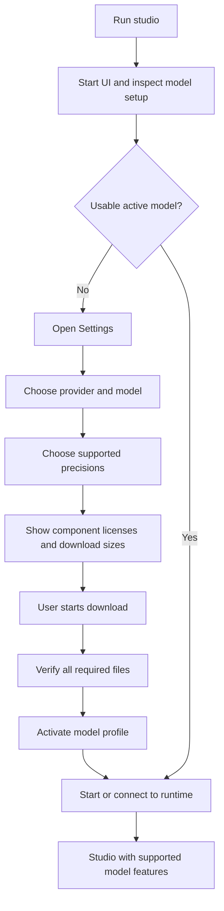

# Product and architecture contract

This is the agreed direction for Lux In Music. The requirement ledger records
which parts are implemented. Target behavior described here is not evidence
that the current prototype already implements it.

## Purpose

Lux In Music is a generative music application with a shared studio, job queue,
library, and editing UI. Local generation uses models compatible with audio.cpp.
The shared application should not depend on one model family. A future provider,
such as MiniMax, would need a separate integration and documented capabilities;
it is not assumed to run through audio.cpp or to expose local weights or a VAE.

## Current implementation

The Python API and browser app use one audio.cpp server. `studio/params.py`
contains YuE2-specific parameters. `studio/edit.py` assumes YuE2 semantic tokens
at 25 frames/second and 48 kHz audio. Separation also calls audio.cpp directly.
The launch scripts require the engine, and `scripts/setup.sh` downloads fixed
generation and separation models. There is no Settings/model manager yet.

The present profile is YuE2-3B Q8_0 with an F16 VAE. The fixed server config is
`config/audiocpp-server.json`. These are migration facts, not permanent defaults.

## Target startup and Settings flow

1. Installing Lux installs software dependencies, without selecting/downloading
   weights. Optional separation weights follow the same opt-in rule.
2. Running the studio must open the UI even when no weights or engine exist.
   With no usable active profile, Settings is the first view; generation is
   unavailable until setup completes. Existing library audio remains accessible.
3. Settings discovers existing downloads and records an explicit selection.
   Missing, incomplete, incompatible, or corrupt files cannot be activated.
4. Show the model and each component's license identifier, source link, revision,
   and material use restrictions before the download action. Record the user's
   acknowledgement for those releases. A changed license/release needs review.
   Unknown licenses need resolution before offering the download.
5. Downloads expose progress, failure/retry, cancellation, verification, and
   the required disk space. Activation failures retain the last working profile.
6. The UI exposes the active model's capabilities. Planning, ABC input, semantic
   editing, VAE selection, and local precision controls are conditional features.

## Target boundaries

| Boundary | Responsibilities |
| --- | --- |
| Shared application | Song inputs, queue, library, audio artifacts, Settings UI |
| Provider/runtime adapter | Connection, lifecycle, readiness, request transport, results |
| Model adapter | Parameter validation, capabilities, token/audio formats, model-specific stages |
| Model catalog | Supported artifacts, compatible combinations, licenses, revisions, checksums/sizes |
| Download manager | User-requested transfer, progress, cancellation/resume, integrity verification |
| Model profile store | Selected provider/model/VAE, precisions, paths, readiness and effective configuration |

Start by extracting the existing audio.cpp/YuE2 behavior, not by writing a new
inference framework. Validate shared code using a small fake provider. Local
generation and separation services must be configurable independently.

## Precision and VAE choices

Published YuE2 audio.cpp artifacts include:

| Component | Precision | Filename |
| --- | --- | --- |
| Main model | Q8_0 | `yue2-3b-q8_0.gguf` |
| Main model | BF16 | `yue2-3b-bf16.gguf` |
| Main model | Q4_0 | `yue2-3b-q4_0.gguf` |
| VAE | F16 | `yue2-vae-f16.gguf` |
| VAE | F32 | `yue2-vae-f32.gguf` |

BF16 and FP16 are distinct 16-bit floating-point formats. Do not rename BF16
as FP16 or invent an FP16 YuE2 download. Choose main weights and VAE separately;
after selecting YuE2, F16 is the default VAE choice and F32 is an alternative.
Each pairing still needs validation with the actual runtime/device.

The requested BF16 main (~7.26 GB) plus F32 VAE (~0.53 GB) has about 7.8 GB of
weights. This rounded estimate is not peak runtime memory. Cache, Metal buffers,
and temporary allocations add overhead. Distinguish GB from GiB and show measured
runtime memory separately when available. Precision is a resource/fidelity choice,
not a guaranteed audible improvement or a fix for song endings.

Source: [YuE2 GGUF release](https://huggingface.co/audio-cpp/Yue2-3B-GGUF).
The current model card declares CC BY-NC 4.0. Confirm the model and VAE licenses
for the exact releases used; do not infer every component's license from the
application license or another component. The [license deed](https://creativecommons.org/licenses/by-nc/4.0/)
describes attribution and noncommercial requirements and links the full terms.

## Job, song, and editing records

Capture the effective profile when queueing a job. Changing Settings only affects
new jobs. Each song records provider/model IDs and revisions, main/VAE precisions,
component licenses, runtime/backend, seed, effective options, and stage/truncation
information. Secrets do not belong in these records. Preserve older metadata;
an edit must resolve the original compatible model or explain what is missing.

YuE2's semantic cap currently sets maximum length, not a composition target.
Completion needs the ending/truncation signals plus listening, not just a valid
WAV. Model adapters must express duration support accurately.

## Delivery order and evidence

- #4: product/package naming and the shared contributor harness.
- #2: provider boundaries, UI-first startup, profiles and capabilities.
- #3: Settings, license display, downloads and independent precision choices.
- #1: duration-aware composition and natural song endings.

Use [the requirement ledger](../harness/requirements.json) for acceptance scenarios
and links. Keep architectural changes explicit here, with the reason and affected
requirements. Do not label proposed boundaries or features implemented without
their corresponding checks and, where relevant, a UI/audio verification.
