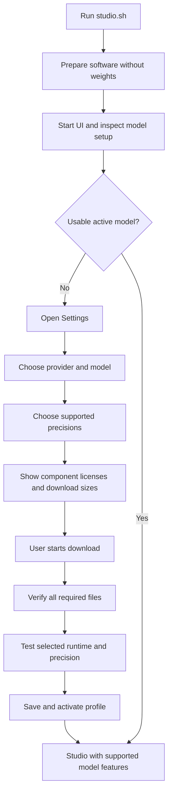

# Product and architecture contract

This is the product contract for Lux In Music. The requirement ledger records
implementation status and executable checks. Duration-aware endings have a
recorded native audio test and user listening acceptance.

## Purpose

Lux In Music is a generative music application with a shared studio, job queue,
library, and editing UI. Local generation uses models compatible with audio.cpp.
The shared application should not depend on one model family. A future provider,
such as MiniMax, would need a separate integration and documented capabilities;
it is not assumed to run through audio.cpp or to expose local weights or a VAE.

## Current implementation

Shared song inputs, queue, results and library use provider/profile contracts.
`studio/adapters/yue2.py` owns YuE2 options, token rates and capability declarations;
`yue2_edit.py` owns its semantic editing format. Shared audio helpers read actual
WAV rates. `studio/providers.py` owns audio.cpp transport, process lifecycle and
runtime probes. Generation and separation have separate lazy runtime slots.

Genre templates belong to the shared Create UI: they load the shared Melodic
Techno demo lyrics with a genre style, preserve title/settings, and make no
inference request. The lyric text has one source in the existing demo.

Settings uses the pinned catalog and `studio/models.py` to verify/download files,
record license reviews, and activate tested profiles. The UI starts without an
engine. `studio.sh` prepares software, without weights, before serving the UI.
There is no active model on a fresh install. The previous Q8_0/F16 files are
detected as migration candidates, but require license review and verification.

## Startup and Settings flow

1. Installing Lux installs software dependencies, without selecting/downloading
   weights. Optional separation weights follow the same opt-in rule.
2. Running the studio must open the UI even when no weights or engine exist.
   With no usable active profile, Settings is the first view; generation is
   unavailable until setup completes. Existing library audio remains accessible.
3. Settings discovers existing downloads and records an explicit selection.
   Missing, incomplete, incompatible, or corrupt files cannot be activated.
4. Show the model and each component's license identifier, source link, revision,
   and material use restrictions before the download action. Record the user's
   acknowledgement for those releases. A changed license/release needs review.
   Unknown licenses need resolution before offering the download.
5. Downloads expose progress, failure/retry, cancellation, verification, and
   the required disk space. Activation failures retain the last working profile.
6. The UI exposes the active model's capabilities. Planning, ABC input, semantic
   editing, VAE selection, and local precision controls are conditional features.

## Boundaries

| Boundary | Responsibilities |
| --- | --- |
| Shared application | Song inputs, queue, library, audio artifacts, Settings UI |
| Provider/runtime adapter | Connection, lifecycle, readiness, request transport, results |
| Model adapter | Parameter validation, capabilities, token/audio formats, model-specific stages |
| Model catalog | Supported artifacts, compatible combinations, licenses, revisions, checksums/sizes |
| Download manager | User-requested transfer, progress, cancellation/resume, integrity verification |
| Model profile store | Selected provider/model/VAE, precisions, paths, readiness and effective configuration |

The shared contract is validated using a small fake provider with no YuE2 options.
An external delivery profile has no local paths, weights, precision or VAE. Its
provider probe confirms readiness. This is an extension point; it does not
implement a third-party service, credentials UI, billing or MiniMax support.

## Storage and activation decisions

- Native source submodules use command-scoped GitHub SSH-to-HTTPS URL rewrites.
  Fresh setup and retries must work without SSH keys. Do not modify global Git
  configuration or the pinned upstream source to select a transport.
- Catalog file URLs, sizes and integrity hashes are tied to immutable releases.
  LFS artifacts use SHA-256; small Git sidecars use Git blob SHA-1.
- Settings records acknowledgement of the exact license/release digest before
  any transfer. A changed release or license document invalidates that review.
- Each release has its own directory. Legacy files are hashed before hardlinking
  or copying into that directory. Replacements are verified before atomic rename;
  old songs' release files are not overwritten by a newer release.
- Partial downloads stay resumable. Invalid ranges and corrupt completed files
  fail setup. Cancellation cannot interrupt an already running native inference;
  it can cancel its wait and prevent activation when the inference finishes.
- Activation requires complete verified files and a valid nonempty WAV from a
  short native probe. Save failure rolls back the in-memory active selection.
  Device/backend or binary fingerprint changes invalidate local readiness.
- Separation profiles declare input sample rate and channels. Both the probe
  and song-separation input conversion use that contract: 44,100 Hz for
  HTDemucs/BS-RoFormer and 48,000 Hz for SAM Audio. Probe request options must
  match the model API; only SAM Audio receives a text prompt and seed here.
  Older saved separation profiles retain their mode-format fallback.
- Restore the active precision/VAE choice and recorded license review in Settings
  after reload. A verified profile can be selected again without hashing or
  probing unchanged files. Compare the current release, files, paths and runtime
  token before reuse. Explicit repair performs full verification again.
- Each model card owns its setup action, progress and latest relevant error.
  Active verified generation and separation profiles have disabled status buttons.
  Successful setup history is not rendered in Settings. Repair is an explicit
  action under Maintenance. New license documents require review, while unchanged
  file/runtime validation can be reused after that acknowledgement.
- A source pin describes the supported native build. External binaries record
  their path and compatibility fingerprint, without claiming a known source revision.
- Provider locks protect a runtime during inference. Queued jobs keep a profile
  snapshot; the runtime switches to that profile when the job runs. No arbitrary
  existing processes are terminated. Only the studio's subprocesses are owned.
- The catalog reports a BS-RoFormer publisher license declaration with its
  original checkpoint provenance caveat. Keep that caveat visible; do not describe
  the declaration as proof of the original checkpoint's licensing history.

## Precision and VAE choices

Published YuE2 audio.cpp artifacts include:

| Component | Precision | Filename |
| --- | --- | --- |
| Main model | Q8_0 | `yue2-3b-q8_0.gguf` |
| Main model | BF16 | `yue2-3b-bf16.gguf` |
| Main model | Q4_0 | `yue2-3b-q4_0.gguf` |
| VAE | F16 | `yue2-vae-f16.gguf` |
| VAE | F32 | `yue2-vae-f32.gguf` |

BF16 and FP16 are distinct 16-bit floating-point formats. Do not rename BF16
as FP16 or invent an FP16 YuE2 download. Choose main weights and VAE separately;
after selecting YuE2, F16 is the default VAE choice and F32 is an alternative.
Each pairing still needs validation with the actual runtime/device.

The requested BF16 main (~7.26 GB) plus F32 VAE (~0.53 GB) has about 7.8 GB of
weights. This rounded estimate is not peak runtime memory. Cache, Metal buffers,
and temporary allocations add overhead. Distinguish GB from GiB and show measured
runtime memory separately when available. Precision is a resource/fidelity choice,
not a guaranteed audible improvement or a fix for song endings.

Source: [pinned YuE2 GGUF release](https://huggingface.co/audio-cpp/Yue2-3B-GGUF/blob/cca74d8980c00f30ab8d52248a367c01ad633ec2/README.md).
The model card declares CC BY-NC 4.0. Confirm the model and VAE licenses
for the exact releases used; do not infer every component's license from the
application license or another component. The [license deed](https://creativecommons.org/licenses/by-nc/4.0/)
describes attribution and noncommercial requirements and links the full terms.

## Job, song, and editing records

Capture the effective profile when queueing a job. Changing Settings only affects
new jobs. Each song records provider/model IDs and revisions, main/VAE precisions,
component licenses, runtime/backend, seed, effective options, and stage/truncation
information. Secrets do not belong in these records. Preserve older metadata;
an edit must resolve the original compatible model or explain what is missing.

`target_duration_s` is a composition target distinct from `max_duration_s`.
YuE2 owns staged score inspection, conservative instrumental shortening, bounded
planning/semantic retries and EOS checks before rendering. Shared storage retains
adapter-provided generation diagnostics and failed reports. Existing profiles
receive current adapter capabilities without changing their saved file/runtime
validation. Queued/song snapshots remain immutable.

The YuE2 cap still means a cap. Target mode only renders an EOS stream near the
target; clip mode preserves and labels forced truncation. Forced-stream rendering
metadata is separate from composing-stage EOS. Completion needs listening too;
the user accepted the recorded example. See [song endings](song-endings.md)
for the duration limits, arrangement policy, evidence and model limitations.

A queued job can be removed and a running generation can be stopped. audio.cpp
has no request cancellation, so stopping terminates the generation engine; the
next job restarts it and loads the model again. A stopped job writes no song.
Separation and stem edits can only be removed while queued.

## Delivery and evidence

- #4: product/package naming and the shared contributor harness.
- #2: provider boundaries, software bootstrap, UI-first startup, profiles and capabilities.
- #3: Settings, license display, downloads and independent precision choices.
- #1: duration-aware composition and natural song endings.

Use [the requirement ledger](../harness/requirements.json) for acceptance scenarios
and links. Keep architectural changes explicit here, with the reason and affected
requirements. Do not label proposed boundaries or features implemented without
their corresponding checks and, where relevant, a UI/audio verification.
